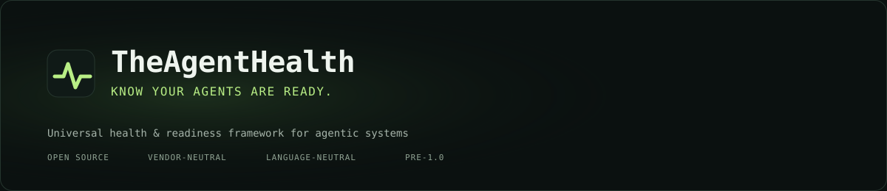

<div align="center">



<br/>

[](https://github.com/TheAgentHealth/agenthealth/releases)
[](https://github.com/TheAgentHealth/agenthealth/blob/main/LICENSE)
[](https://github.com/TheAgentHealth/agenthealth/stargazers)
[](https://github.com/TheAgentHealth/agenthealth/blob/main/ROADMAP.md)

</div>

AgentHealth is an open-source, vendor-neutral, framework-neutral, and
language-neutral project for determining whether AI agents and the
infrastructure they depend on are **reachable, correctly configured,
responsive, ready, and operationally healthy**.

## 📦 Repositories

<table>
<tr>
<td width="50%" valign="top">

### [🩺 agenthealth](https://github.com/TheAgentHealth/agenthealth)

Core project — spec, CLI, and adapters for HTTP/API, MCP, A2A, agent,
gateway, and router targets.

</td>
<td width="50%" valign="top">

### [🌐 theagenthealth.github.io](https://theagenthealth.github.io/)

Project website. Source:
[theagenthealth.github.io (repo)](https://github.com/TheAgentHealth/theagenthealth.github.io)

</td>
</tr>
</table>

## 🚀 Getting started

```bash
docker run --rm theagenthealth/agenthealth:latest version
docker run --rm theagenthealth/agenthealth:latest ping http http://localhost:8080/health
```

| | |
|---|---|
| ⬇️ Install | [CLI, Docker, Helm, and package downloads](https://github.com/TheAgentHealth/agenthealth#install) |
| 📐 Specification | [Protocol, configuration, and result schema](https://github.com/TheAgentHealth/agenthealth/tree/main/spec) |
| 📚 Documentation | [Guides and reference](https://github.com/TheAgentHealth/agenthealth/tree/main/docs) |
| 🗺️ Roadmap | [What's shipped and what's next](https://github.com/TheAgentHealth/agenthealth/blob/main/ROADMAP.md) |

## 🤝 Community

[Contributing](https://github.com/TheAgentHealth/agenthealth/blob/main/CONTRIBUTING.md) ·
[Code of Conduct](https://github.com/TheAgentHealth/agenthealth/blob/main/CODE_OF_CONDUCT.md) ·
[Security policy](https://github.com/TheAgentHealth/agenthealth/blob/main/SECURITY.md)

<sub>Licensed under Apache 2.0.</sub>
